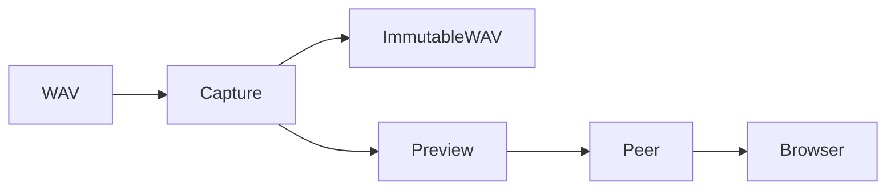

  

  
  

# MedEx
MedEx provides two source projects, `core/med_rtc` for replay and WebRTC peers, and `core/med_web` for browser signaling. Fabric owns clinical decisions. Consumers depend on one commit-pinned Git SDK named `:med_ex`.

On Ubuntu 26.04 install Git, curl, tar, build-essential, shasum and uv. Activate the exact Erlang and Elixir in .tool-versions through asdf or mise. Run `./onboard.sh --fixture`, `mix ci` and `mix weld.verify`.

`MedRTC.WavCapture.record/4` takes WAV input, a prepared Opus preview, an existing output directory and acquisition options. The result identifies the complete WAV and its decoded PCM separately. Each peer is owned by its channel. The browser host supplies the socket path, topic and control selectors to `createMedExHook`. See the Fabric exam for the released integration.

