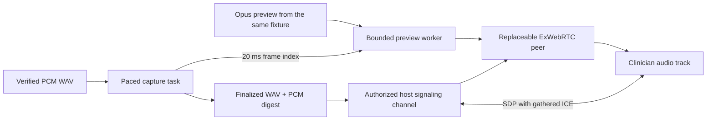

<p align="center">
  
</p>

<p align="center">
  <a href="https://github.com/nshkrdotcom/med_ex">
    
  </a>
  <a href="https://github.com/nshkrdotcom/med_ex/blob/main/LICENSE">
    
  </a>
</p>

# MedEx

`MedEx` is a reusable Elixir SDK poncho for live clinical device sessions, WebRTC transport, and independent recording integrity. It separates what the clinician hears live over WebRTC from what the device records losslessly, so a browser disconnect never corrupts or mislabels a clinical capture.

The repository is a non-umbrella Elixir poncho managed with Blitz (parallel checks) and Weld (single-artifact SDK projection). Downstream apps such as `med_fabric/apps/exam` consume one OTP application (`:med_ex`), never individual internal path dependencies.

---

## What This Owns (and Does Not Own)

**`med_ex` owns:**
- Pure live-session state transitions (`MedCore.Session`) with a four-level identity model (`encounter_ref`, `session_id`, `connection_id`, `acquisition_id`) and separate integrity tracking for `{:preview_stream, stream_id}` vs. `{:recording_artifact, acquisition_id}`.
- OTP runtime and WebRTC/audio transport (`MedRTC.SessionServer`, `MedRTC.PeerLoopback` over `ExWebRTC`, `MedRTC.WavCapture` one-input/two-output WAV replay).
- Reusable signaling event helpers and the shipped browser WebRTC JavaScript hook (`MedWeb.Signaling`, `priv/static/med_web/session_hook.js`).
- Opt-in real-time signal/inference contracts (`MedAdapters.Inference`, excluded from the default `:med_ex` projection).
- A minimal standalone reference app (`apps/med_pulse`) proving `:med_ex` works without `encounter_ref` or `med_fabric`.

**`med_ex` does not own:**
- Durable clinical encounters, clinician observation acceptance, transactional outbox storage, HL7 FHIR delivery, or production Phoenix endpoints/LiveViews/signaling channels. Those live in the companion `med_fabric` workspace (`med_fabric/apps/exam` consumes `:med_ex` one-way).

---

## Package Map

| Package | Path | Included in `:med_ex` SDK? | Implemented Today | Documentation |
| --- | --- | --- | --- | --- |
| **MedCore** | `core/med_core` | Yes | `MedCore.Session`, `MedCore.StreamSpec`, `MedCore.Profile` | [core/med_core/README.md](core/med_core/README.md) |
| **MedRTC** | `core/med_rtc` | Yes | `MedRTC.SessionServer`, `MedRTC.PeerLoopback` (`ExWebRTC`), `MedRTC.WavCapture` | [core/med_rtc/README.md](core/med_rtc/README.md) |
| **MedWeb** | `core/med_web` | Yes | `MedWeb.Signaling`, `priv/static/med_web/session_hook.js` | [core/med_web/README.md](core/med_web/README.md) |
| **MedAdapters** | `core/med_adapters` | No (opt-in source) | `MedAdapters.Inference` behaviour + advisory envelope | [core/med_adapters/README.md](core/med_adapters/README.md) |
| **MedPulse** | `apps/med_pulse` | No (proof app) | `MedPulse.ClinicalProfile` + standalone WAV/reconnect test | [apps/med_pulse/README.md](apps/med_pulse/README.md) |

---

## Walkthrough: Reconnect & Independent Capture Integrity

Trace this path in `core/med_rtc/test/wav_capture_test.exs` and `core/med_core/test/med_core_test.exs`:

1. Start a `MedCore.Session` inside `MedRTC.SessionServer` and connect a real `ExWebRTC` loopback peer (`conn_a`).
2. Start an acquisition (`acq_1`) and replay a 4 kHz 16-bit mono PCM WAV (such as PhysioNet CirCor DigiScope `2530_AV.wav`) through `MedRTC.WavCapture.replay/2`.
3. Drop the live WebRTC preview (`conn_a`) mid-capture so 40 preview chunks fail while the lossless collector records all 94,400 samples with an unchanged SHA-256 digest.
4. Dispatch `capture_completed` (and dispatch it a second time with a new `delivery_id`), then reconnect the clinician on `conn_b`.
5. `MedCore.Session` records one closed preview interruption on `{:preview_stream, "auscultation"}`, marks `{:recording_artifact, "acq_1"}` as `:observed_continuous`, ignores late disconnects from replaced `conn_a`, deduplicates identical completion deliveries, and flags conflicting digests as `:conflict`.

---

## Commands & Verification

Toolchain pins live in `.tool-versions` (`erlang 29.1.2`, `elixir 1.20.5-otp-29`). Ordinary Elixir, Blitz, and Weld checks run without external services once dependencies are installed.

```bash
# Inner dev loop (parallel across all 5 child projects via Blitz)
mix deps.get
mix monorepo.deps.get
mix ci
mix monorepo.dialyzer
mix monorepo.docs && mix docs

# Welded :med_ex SDK projection & provenance checks
mix med_ex.projection.refresh
mix med_ex.projection.status --strict
mix weld.inspect
mix weld.verify

# Publish verified projection to orphan branch projection/med_ex
mix weld.release.prepare
mix weld.release.track --push

# Optional: download real PhysioNet CirCor 2530_AV.wav (gitignored) & verify PCM SHA-256 via uv
./fixtures/circor/prepare.sh
UV_PROJECT_ENVIRONMENT="$HOME/.cache/med_ex/waveforms-venv" \
  uv run --locked --project tools/waveforms \
  python tools/waveforms/check_wav.py fixtures/circor/2530_AV.wav
```

> **Note on `UV_PROJECT_ENVIRONMENT`**: Keeping the Python venv under `~/.cache/med_ex/waveforms-venv` avoids placing external interpreter symlinks inside the Git working tree, keeping `mix_workspace_ops doctor` clean.

> **Current verification boundary**: ExWebRTC peer negotiation, WAV replay across preview drops, JS hook syntax (`node --check`), and Weld packaging are verified automatically in CI. A live desktop-browser audio run (MedEx server → real Chromium/Firefox browser via `session_hook.js`) remains an open desktop-browser exit criterion because this headless host has no Chromium/Playwright installed.

---

## Upstream Ecosystem

- Blitz: https://github.com/nshkrdotcom/blitz
- Weld: https://github.com/nshkrdotcom/weld
- ExWebRTC: https://github.com/elixir-webrtc/ex_webrtc
- LiveExWebRTC: https://github.com/elixir-webrtc/live_ex_webrtc
- ExSCTP: https://github.com/elixir-webrtc/ex_sctp
- Membrane Core: https://github.com/membraneframework/membrane_core
- PhysioNet CirCor DigiScope Phonocardiogram Dataset: https://physionet.org/content/circor-heart-sound/1.0.3/

## License

MIT — see [LICENSE](LICENSE).

## Browser capture architecture



The host starts `MedRTC.WavCapture.record/4` in an acquisition task. A separate worker supplies best-effort Opus preview frames. The browser's peer can close or rejoin without interrupting the acquisition. The task returns a finalized WAV path, decoded PCM SHA-256, retained frame count, duration and measured continuity. The host owns access to the artifact and starts any review or clinical persistence.

To prepare the real fixture with the shipped lock, install uv and run `./fixtures/circor/prepare.sh /path/to/cache` from the source checkout. For a Welded SDK, run `bash <sdk checkout>/priv/fixtures/prepare.sh /path/to/cache`. uv resolves Python 3.12.14 and the pinned FFmpeg wheel for the host. The script verifies the original WAV before producing its 20 ms Opus preview. The fixture is distributed separately from the SDK and retains the attribution recorded in `priv/fixtures/MANIFEST.json`.

The reusable browser hook is created by `createMedExHook(Socket)` from the packaged `priv/static/med_web/session_hook.js`. The host supplies its Phoenix Socket constructor, a signed token in the hook element, and an encounter topic. The preview owns the browser connection. The host authorizes it and hands the gathered offer to `MedRTC.Preview.answer/1`.
