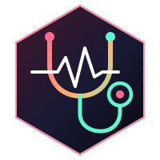

<p align="center">
  
</p>

<p align="center">
  <a href="https://github.com/nshkrdotcom/med_ex">
    
  </a>
  <a href="LICENSE">
    
  </a>
</p>

# PulseScope

`pulse_scope` is the **first vertical-slice clinical product application** built on top of the [MedEx](../../README.md) poncho framework.

It implements Use Case **#1 (Remote Digital Stethoscope)** and Use Case **#4 (Remote Patient Monitoring: Live ECG & SpO₂)** inside one synchronized clinical encounter—exercising **3 of the 4 Clinical Transport Archetypes** simultaneously (`A: Diagnostic Signal`, `B: Lossless Telemetry & Audited Control`, `C: Interactive Opus Talkback`).

---

## Why #1 + #4 Is the First Vertical Slice

1. **High architectural coverage**: Immediately proves `med_core`, `med_rtc`, `med_adapters`, and `med_web` across diagnostic audio, lossless sensor framing, audited device control, and real-time voice talkback—making expansion to Use Case **#3 (Connected Telehealth)** a single `StreamSpec` + topology change (`:server_terminated` → `:hybrid`).
2. **Testable Day-1 with real clinical data**: Streams real PhysioNet-2022 CirCor heart sounds (`open-stethoscope`) and MIT-BIH ECG records (`wfdb-python`) over live WebRTC + SCTP via a browser simulator or `pion/webrtc` Go edge binary—no custom FDA hardware required to validate the full stack.
3. **Clean, high-leverage OSS composition**:
   - `ex_webrtc` + `ex_sctp` + `membrane_core` / `membrane_opus_plugin` / `membrane_wav_plugin`
   - `elixir-nx/ortex` + `NoahIsARider/open-stethoscope` (1.6 MB ONNX heart murmur & position-QC in-BEAM)
   - `neuropsychology/NeuroKit` + `MIT-LCP/wfdb-python` (supervised Python Port for 5s ECG/PPG windows & WFDB export)
   - `pion/webrtc` (Go bedside/fixture edge gateway)
   - `hapifhir/hapi-fhir` (or `medplum`) for FHIR R4 `Observation` and `DiagnosticReport` sign-off

---

## Key Engineering Decision: 4 kHz PCM-over-SCTP for Auscultation

Heart and lung sounds live almost entirely between **20 Hz and 2,000 Hz** (Nyquist satisfied cleanly at **4,000 Hz**). Uncompressed 16-bit PCM at 4 kHz requires only **64 kbps** (`4000 * 2 * 8`).

Transporting auscultation audio as **20 ms PCM chunks (80 samples = 160 bytes) over a WebRTC SCTP DataChannel (`ex_sctp`)** alongside a standard **Opus RTP track** for clinician–patient talkback eliminates the hardest browser WebRTC pitfall:

- The human talkback track keeps browser **AEC/NS/AGC turned ON** for natural conversation.
- The diagnostic auscultation path bypasses browser voice DSP and lossy psychoacoustic compression entirely, feeding a dedicated client-side WebAudio `AudioWorklet` with non-destructive **Bell / Diaphragm / Wideband** biquad filters.

---

## Declarative `MedCore.Profile` Composition

`PulseScope.ClinicalProfile` implements `@behaviour MedCore.Profile` with zero boilerplate WebRTC plumbing:

| Stream ID | Archetype | Modality | Codec / Framing | Priority | Key Policy Invariant |
| --- | --- | --- | --- | --- | --- |
| `"device_control"` | `:control` | `:stethoscope` | `{:cbor_signed, PulseScope.ControlSchema}` | `0` | Clinician RBAC + exclusive lease + 2s ACK deadman timeout |
| `"vitals_telemetry"` | `:telemetry` | `:ecg` | `{:binary_frame, PulseScope.VitalsFrame}` | `1` | `0.0%` loss tolerance (exact monotonic `sample_seq` gap detection), 250 Hz ECG + 50 Hz SpO₂ |
| `"auscultation"` | `:diagnostic_audio` | `:stethoscope` | `{:pcm_s16le, 4_000}` | `2` | `require_dsp_disabled: true`, `allow_plc: false`, `max_packet_loss_pct: 0.05` |
| `"talkback_voice"` | `:interactive_media` | `:voice` | `{:opus, bitrate: 32_000, fec: true, dtx: true}` | `3` | Adaptive speech Opus with AEC/NS/AGC enabled |

### Configured Inference Hooks

- `"auscultation"` → `PulseScope.Adapters.OpenStethoscopeOrtex` (`window_ms: 8_000, hop_ms: 2_000`) — gated by `integrity_state == :validated`
- `"vitals_telemetry"` → `PulseScope.Adapters.NeuroKitWorker` (`window_ms: 5_000, hop_ms: 1_000`) — R-peaks, HR, HRV, SQI

---

## End-to-End Clinical Dataflow

1. **Session Init**: Clinician opens `/encounters/:id` (Phoenix LiveView). `MedRTC` boots an `EncounterSupervisor` parameterized by `PulseScope.ClinicalProfile` and issues short-lived DTLS/signaling credentials.
2. **Edge Connect**: Bedside gateway (`pion/webrtc` Go binary or browser fixture streamer) connects over WebRTC (using `rel` TURN behind hospital NATs), opens the Opus RTP track + 3 SCTP DataChannels (`auscultation`, `vitals_telemetry`, `device_control`), and sends a `StreamAttestation` frame certifying hardware sample rates and DSP bypass.
3. **Hot-Path Processing (BEAM)**:
   - `vitals_telemetry` binary frames (`sample_seq :: 64, device_ts_us :: 64, ecg_i16[], spo2_u16`) pass through `MedCore.TimelineAligner` for zero-gap verification, broadcast to LiveView Canvas via `PubSub`, and analyze in 5s overlapping windows via `NeuroKit2`.
   - `auscultation` 20 ms PCM chunks forward to the clinician's `AudioWorklet`, tee into a `membrane_wav_plugin` ring buffer for lossless archival, and score every 2s via `Ortex` (`open-stethoscope` ONNX).
   - `talkback_voice` Opus RTP flows bidirectionally through `ex_webrtc` with sub-150 ms latency.
4. **Audited Control & Clinical Export**: Clinician clicks **"Capture 10s Mitral Clip + Switch Filter: Bell"** → `MedCore.ControlInterlock` verifies role/lease → appends hash-chained audit record → sends signed CBOR command over `device_control` SCTP → receives device ACK → triggers synchronized `.wav` + PhysioNet WFDB `.dat/.hea` export + drafts FHIR `Observation`/`DiagnosticReport` to `HAPI FHIR`.

---

## Planned Module Layout

```text
apps/pulse_scope/lib/
├── pulse_scope.ex
└── pulse_scope/
    ├── clinical_profile.ex
    ├── vitals_frame.ex
    ├── control_schema.ex
    └── control_policy.ex
```

## Related Packages

- [MedEx Workspace Overview](../../README.md)
- [MedCore (Pure Functional Core)](../../core/med_core/README.md)
- [MedRTC (OTP Effect Runtime)](../../core/med_rtc/README.md)
- [MedAdapters (Clinical OSS Ports)](../../core/med_adapters/README.md)
- [MedWeb (LiveView Workbench)](../../core/med_web/README.md)
