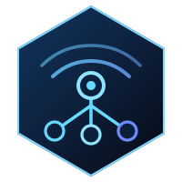

<p align="center">
  
</p>

<p align="center">
  <a href="https://github.com/nshkrdotcom/med_ex">
    
  </a>
  <a href="LICENSE">
    
  </a>
</p>

# MedRTC

`med_rtc` is the OTP runtime and WebRTC/audio transport layer of [MedEx](../../README.md). It holds live session state in a `GenServer`, negotiates real `ExWebRTC` peer connections, and runs one-input/two-output PCM WAV capture replays while delegating all session state decisions to [`med_core`](../med_core/README.md).

---

## What This Owns (and Does Not Own)

**`med_rtc` owns:**
- `MedRTC.SessionServer` — Lightweight `GenServer` holding `%MedCore.Session{}`, dispatching events through `MedCore.Session.step/2`, and forwarding emitted effects to subscribers.
- `MedRTC.PeerLoopback` — Real `ExWebRTC.PeerConnection` SDP offer/answer + ICE `:connected` loopback harness and teardown helper used to verify live WebRTC peer lifecycles and reconnects.
- `MedRTC.WavCapture` — Pure-Elixir 16-bit PCM WAV parser (`parse_wav/1`), encoder (`encode_pcm16_wav/2`), and one-input/two-output `replay/2` splitting a recording stream into an optional live preview sink (which may drop mid-capture) and an independent lossless PCM collector reporting exact `sample_count`, `duration_ms`, `artifact_sha256`, and `continuity` (`:observed_continuous | :observed_gap | :unknown`).

**`med_rtc` does not own:**
- Pure session reducer rules (those live in `med_core`).
- Browser signaling hooks or Phoenix endpoints (`core/med_web` ships the browser JS hook; `med_fabric/apps/exam` owns the Phoenix endpoint and signaling channel).

---

## Walkthrough

In `test/wav_capture_test.exs`:
- When `fixtures/circor/2530_AV.wav` (PhysioNet CirCor DigiScope 4 kHz phonocardiogram) is cached locally via `./fixtures/circor/prepare.sh`, `MedRTC.WavCapture` parses all 94,400 samples (`23,600 ms`) and matches the independent `uv`-locked Python checker's exact PCM SHA-256 (`7c8c93ee4602072aa5c0e4c81a5a9e28d926b278f701218ea588bde9644efc66`).
- Mid-replay, `PeerLoopback.close_pair/1` tears down `conn_a` and drops 40 preview chunks while the lossless collector captures every sample and emits `:observed_continuous`, after which `conn_b` negotiates a fresh `ExWebRTC` connection to the same `SessionServer`.
- When the gitignored WAV isn't cached (such as inside `mix weld.verify`), the test falls back to an encoded 4 kHz PCM WAV exercising the exact same code path.

---

## Commands & Verification

```bash
cd core/med_rtc
mix test
mix credo --strict
mix dialyzer --force-check
```

## Planned Extensions (Deferred Until Needed)

Per-session `:rest_for_one` supervision trees, Membrane audio pipelines (`membrane_opus_plugin`, `membrane_wav_plugin`), `ExSCTP` telemetry channels, and TURN relay integration (`coturn` / `rel`) will be added as real device hardware and live browser media paths require them.

## Upstream Libraries

- ExWebRTC: https://github.com/elixir-webrtc/ex_webrtc
- ExSCTP: https://github.com/elixir-webrtc/ex_sctp
- Membrane Core: https://github.com/membraneframework/membrane_core
- Rel (TURN/STUN): https://github.com/elixir-webrtc/rel

## Related Packages

- [MedEx Workspace](../../README.md)
- [MedCore](../med_core/README.md)
- [MedWeb](../med_web/README.md)
- [MedAdapters](../med_adapters/README.md)
- [MedPulse](../../apps/med_pulse/README.md)
