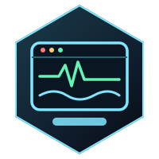

<p align="center">
  
</p>

<p align="center">
  <a href="https://github.com/nshkrdotcom/med_ex">
    
  </a>
  <a href="LICENSE">
    
  </a>
</p>

# MedWeb

`med_web` is the reusable **Phoenix, LiveView, Signaling, and Browser Audio/Waveform Workbench** package for the [MedEx](../../README.md) framework.

Product apps (such as [`apps/med_pulse`](../../apps/med_pulse/README.md)) compose `med_web` LiveComponents and JS hooks directly so clinical UI primitives—signal integrity badges, time-aligned multi-stream waveform canvases, audited control bars, and DSP-safe WebAudio worklets—are never re-implemented per product.

---

## Core Surface Area (Phase 1D)

### 1. Authenticated WebRTC Signaling (`MedWeb.Signaling`)

- Issues and verifies short-lived signed Phoenix tokens bound to `(encounter_id, participant_role, allowed_stream_ids)`.
- Bridges browser SDP offers/answers, ICE candidates, and `MediaStreamTrack.getSettings()` DSP-off attestations directly into `MedRTC.EncounterServer` as normalized `%MedCore.Event{}` structs.
- Integrates with **LiveExWebRTC** (<https://github.com/elixir-webrtc/live_ex_webrtc>) and **Membrane WebRTC Plugin** JS hooks (<https://github.com/membraneframework/membrane_webrtc_plugin>).

### 2. Reusable Clinical LiveComponents (`MedWeb.Components`)

| Component | Role |
| --- | --- |
| `<.med_session />` | Manages encounter lifecycle subscription, WebRTC signaling hook, and graceful degradation banners (`:nominal` → `:critical_telemetry_only`). |
| `<.signal_integrity_badge />` | Real-time diagnostic attestation indicator (`:unverified`, `:validated`, `:degraded`) showing exact failure causes (DSP enabled, packet loss, clipping, sample gap) and gating advisory AI readouts. |
| `<.sync_waveform_canvas />` | 30–60 Hz Canvas/WebGL hook rendering time-aligned multi-stream traces (e.g., 250 Hz Lead-II ECG + 50 Hz SpO₂ PPG + 4 kHz phonocardiogram) anchored on `encounter_t_ms` from `MedCore.TimelineAligner`. |
| `<.control_interlock_bar />` | Role-gated clinician control bar acquiring exclusive device leases, dispatching nonce-tracked commands, rendering ACK countdowns, and displaying `:safe_fallback` alerts. |

### 3. Browser Diagnostic Audio (`WebAudio AudioWorklet`)

- Dedicated `AudioWorklet` ring buffer for zero-glitch 4 kHz 16-bit PCM playback delivered over `ex_sctp` DataChannels—completely decoupled from browser AEC/NS/AGC used by the simultaneous Opus talkback track.
- Non-destructive client-side biquad filters (**Bell**, **Diaphragm**, **Wideband**) that never mutate the raw archived PCM stream.

### 4. Operational Telemetry (`LiveDashboard`)

- Integrates **ExWebRTC Dashboard** (<https://github.com/elixir-webrtc/ex_webrtc_dashboard>) into Phoenix LiveDashboard for live ICE state, DTLS handshakes, RTCP jitter, and packet-loss observability per encounter.

---

## Planned Module Layout

```text
core/med_web/lib/
├── med_web.ex
└── med_web/
    ├── token.ex
    ├── signaling_channel.ex
    ├── components.ex
    └── telemetry.ex
```

## Related Packages

- [MedEx Workspace Overview](../../README.md)
- [MedCore (Pure Functional Core)](../med_core/README.md)
- [MedRTC (OTP Effect Runtime)](../med_rtc/README.md)
- [MedAdapters (Clinical OSS Ports)](../med_adapters/README.md)
- [MedPulse (First Reference App)](../../apps/med_pulse/README.md)
