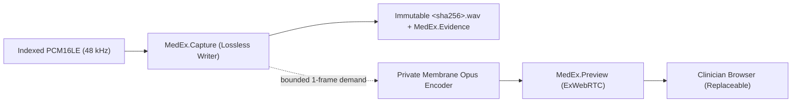

# Architecture and roadmap

MedEx provides real-time clinical media capture and WebRTC preview transport for
Elixir applications. Host applications own authorization, encounter state,
clinician review, persistence, and healthcare record export—MedEx has no
database, Phoenix server, or FHIR dependency.

## Why two separate media paths?

Clinical diagnostic audio (such as remote auscultation) has conflicting
requirements:

- **Live listening** needs low-latency, resilient WebRTC Opus streaming that can
  drop packets or reconnect peers across network hiccups.
- **Authoritative recording** needs bit-exact, continuous, lossless PCM audio
  whose integrity is never compromised by WebRTC jitter, Opus compression, or
  clinician browser disconnects.

MedEx enforces this split in its process boundaries: live indexed PCM enters
`MedEx.Capture`, which writes the lossless WAV directly and fans full 20 ms
frames out to a bounded, disposable preview branch (`Membrane.Opus.Encoder`
kept private behind `MedEx.Capture` → `MedEx.Preview` over `ExWebRTC`).

## Process ownership and failure domains

| Component | Owner | Failure behavior |
| --- | --- | --- |
| `MedEx.Capture` | Host `DynamicSupervisor` (`restart: :temporary`, no global names) | Accepts writes and finish from its monitored `:owner` PID, and aborts and deletes its `.part` file if the producer exits before `finish/1`. |
| Preview encoder pipeline | Private to `MedEx.Capture` (`Membrane.Opus.Encoder`, `application: :audio`) | Isolated via trapped exits; if the encoder exits, capture notifies the subscriber with `{:med_ex_preview_failed, pid, reason}` and keeps recording. |
| `MedEx.Preview` peer | Host signaling channel process | A second subscriber displaces the first with an explicit replacement event. Capture continues across peer loss. |
| `MedEx.Evidence` | Returned to host on `finish/1` | Carries `kind: :audio_pcm16_wav`, content-addressed `artifact_key`, separate `file_sha256` and `pcm_sha256`, sample bounds, and continuity verdict. |

## Releases and roadmap

| Capability | Status | Notes |
| --- | --- | --- |
| Indexed mono 48 kHz PCM16LE capture → immutable WAV + `MedEx.Evidence` | **Shipped (0.1.0)** | `MedEx.Capture`, `MedEx.Evidence`, 30-minute cap, strict contiguity enforcement. |
| Bounded live Opus encoding + replaceable send-only WebRTC preview | **Shipped (0.1.0)** | `MedEx.Preview` (`ExWebRTC` + `ExRTP`), host-configurable `:ice_servers`, private `Membrane.Opus.Encoder`. |
| Browser AudioWorklet PCM capture & LiveView preview hook assets | **Shipped (0.1.0)** | `MedEx.Web.asset_path/1` (`session_hook.js`, `pcm_capture.js`, `pcm_worklet.js`). |
| Selectable browser input, observed settings, bounded acknowledgement window, producer checks, and relay-only policy | **0.2.0 source** | Host configures acquisition provenance and supplies ICE credentials for browser and server. |
| Hardware / gateway PCM sources (USB stethoscopes, BLE gateways) | **Planned** | Feed the same `MedEx.Capture.push/3` indexed PCM contract once a named device is verified end-to-end. |
| Non-audio modalities (multi-channel ECG/PPG waveforms, video tracks) | **Planned** | Will define modality-specific capture and evidence contracts alongside `kind: :audio_pcm16_wav` rather than overloading PCM audio fields. |
| Out-of-band signal analysis & inference workers (NeuroKit2, WFDB-Python, ONNX, voice AI) | **Planned** | Separately installed/deployed packages or workers consuming finalized `MedEx.Evidence` outside capture and emitting derived results with source digest and algorithm provenance. |
| Multiparty SFU topologies (e.g. LiveKit) & managed TURN deployments | **Planned** | External media services integrated when a product topology requires multiparty forwarding or NAT relay. |

See [Host integration](host_integration.md) for the current SDK contract.
