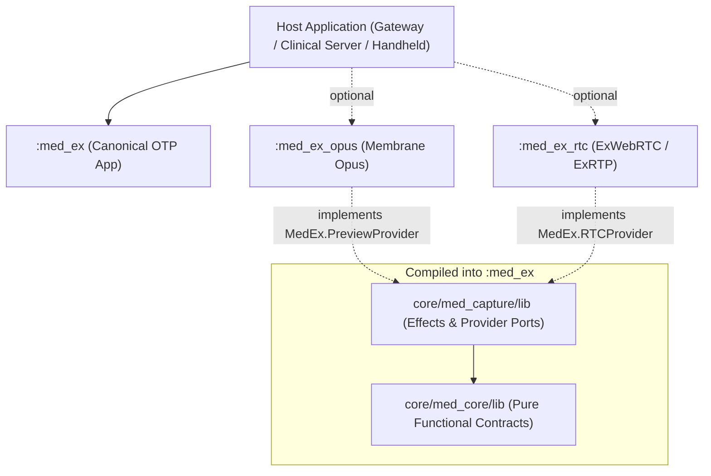

# Architecture and Composition

`MedEx` is structured around one canonical public OTP application—`:med_ex`—paired with two opt-in media provider packages (`:med_ex_opus` and `:med_ex_rtc`). Its internal source layout enforces a strict one-way boundary between pure medical-device contracts and bounded local storage/transport effects.

## Canonical Mix Composition And Source Ownership

- **Single base application (`:med_ex`):** The root `mix.exs` compiles `core/med_core/lib` and `core/med_capture/lib` directly into `:med_ex`, ships browser compatibility assets under `priv/static/med_web/`, and requires only OTP `:logger` and `:crypto` at runtime.
- **Internal boundary-proof projects:** `core/med_core/mix.exs` and `core/med_capture/mix.exs` exist only so CI can compile and test each layer in isolation. Downstream consumers must **never** depend on `:med_core`, `:med_capture`, or the retired `:med_rtc` alongside `:med_ex`, as doing so would create duplicate BEAM module ownership.
- **Automated architecture enforcement:** `./build_support/check_architecture.sh` compiles `core/med_core`, `core/med_capture`, and the root `:med_ex` project independently, verifies dependency allowlists (`build_support/boundary_check.exs`), confirms 1:1 module ownership (`build_support/module_ownership.exs`), checks BEAM compile-info source paths and cross-module call/struct references, and rejects dynamic module dispatch in pure contracts (`build_support/check_architecture.exs`).

## Pure Contracts Versus Explicit Effects

### `core/med_core` — Pure Values, Framing, And Transitions

`core/med_core` performs zero filesystem I/O, zero network I/O, zero process spawning, and zero wall-clock or OS environment reads:

- **Stream and event data contracts:** `MedEx.StreamSpec`, `MedEx.SampleFrame`, `MedEx.FrameFingerprint`, `MedEx.MeasurementEvent`, `MedEx.StatusEvent`, `MedEx.IntegritySpan`, `MedEx.SegmentRef`, and `MedEx.StreamIndex`.
- **Pure state transitions:** `MedEx.StreamCursor.plan/2` validates incoming frames or gaps and returns proposed next cursors plus explicit effect intents (`[{:append, frame}]`, `[{:gap, gap}]`, `{:reconcile, frame}`, or `{:replay, {next_seq, next_sample}}`). `MedEx.ControlInterlock` models persist-before-dispatch device command lifecycles as pure state + effect lists.
- **Deterministic framing and math:** `MedEx.Wire.FrameV1` (`MEX1` 48-byte binary header), `MedEx.Wire.Control` (`medex.device.v1` JSON envelope with duplicate-key rejection), `MedEx.Serialization` / `MedEx.CanonicalJSON` (`MEJ1` canonical encoding), `MedEx.ClockAlign` (exact rational affine clock bounds), and browser WAV rules (`MedEx.Format.Wav`, `MedEx.Preview.Clock`).

### `core/med_capture` — Bounded Local Effects And Provider Ports

`core/med_capture` executes local storage effects and defines explicit behaviours for optional media:

- **Fenced multi-stream recording:** `MedEx.StreamWriter` and `MedEx.Storage` (`MedEx.Storage.File`) persist content-addressed `.pcm` chunks and hash-chained `stream.mejournal` entries on a local POSIX filesystem.
- **Browser continuous WAV compatibility:** `MedEx.Capture`, `MedEx.Wav`, and `MedEx.Web` preserve continuous 48 kHz mono PCM16LE WAV recording and JavaScript asset lookup.
- **Optional media ports:** `MedEx.PreviewProvider`, `MedEx.RTCProvider`, and `MedEx.Preview` decouple capture from native codecs and WebRTC stacks.

## Host-Owned OTP Supervision

`:med_ex` defines `def application, do: [extra_applications: [:logger, :crypto]]` with **no `mod:` callback**. Starting `:med_ex` boots no supervisors, registries, ETS tables, or sockets:

- Both `MedEx.StreamWriter` and `MedEx.Capture` use `use GenServer, restart: :temporary`, register no global names, monitor their `:owner` PID, and accept mutating calls only from that `:owner` (plus matching `:fence` tokens on `StreamWriter`).
- Hosts supervise writers under their own `DynamicSupervisor` or per-session supervision trees and control admission, backpressure credits, writer fencing, quiescence confirmation, and crash recovery.

## Optional Media Extensions And Failure Isolation

`extensions/med_ex_opus` (`:med_ex_opus`) and `extensions/med_ex_rtc` (`:med_ex_rtc`) are separate Mix projects and OTP applications:

- **Compile-time optionality:** Omitting `:med_ex_opus` and `:med_ex_rtc` avoids compiling Membrane, `libopus`, `ex_webrtc`, `ex_dtls`, or `ex_libsrtp`.
- **Runtime optionality:** Without providers configured, `MedEx.Capture.subscribe/1` returns `{:error, :preview_unavailable}` and `MedEx.Preview.answer/2` returns `{:error, :rtc_unavailable}` while authoritative recording continues normally. Note that `MedEx.Preview` caches the first loaded `:rtc_provider` module in `:persistent_term` for the VM lifetime, so configure `:med_ex, :rtc_provider` before opening a peer (or invoke `MedEx.PreviewProvider` / `MedEx.RTCProvider` modules directly in new gateway code).
- **Process versus OS failure domains:** Even when supervised in disposable Elixir processes (`MedEx.Opus.Provider`), native NIFs and C libraries share the OS address space of the BEAM node that loads them. Deployments with strict reliability boundaries run authoritative `:med_ex` ingestion in a headless BEAM and isolate `:med_ex_opus` + `:med_ex_rtc` inside a separate sidecar OS process fed over a drop-tolerant loopback channel.

## SDK Responsibilities Versus Host Responsibilities

`MedEx` records faithful device bytes and technical provenance; it does not make clinical or authorization decisions:

| Owned by `MedEx` | Owned by the Host Application |
| --- | --- |
| Stream/measurement/status schemas and validation | Device enrollment, credentials, TLS, and user/encounter authentication |
| `MEX1` binary framing, `MEJ1` canonical JSON, and `FrameFingerprint` | Binding wire `stream_number` handles to authenticated reservations |
| Per-stream fenced `StreamWriter`, `.pcm` chunks, and `.mejournal` sync | Issuing monotonic fences, confirming prior OS-process death, and aggregate disk budgets |
| Exact rational `ClockAlign` bounds and `ControlInterlock` transitions | Supplying qualified oscillator/probe policies and persisting command intents |
| Sealing technical `StreamIndex` artifacts | Clinical review, usability/acceptance workflows, PostgreSQL transactions, and FHIR/DICOM export |
