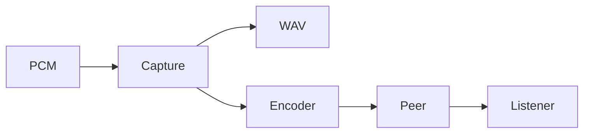

# Architecture and roadmap

MedEx provides media capture and transport for clinical applications. Hosts own authorization and review. MedEx has no encounter store or clinical export dependency.

The current SDK replays PCM WAV and sends a paired Opus preview. The planned 0.1.0 interface accepts live indexed PCM and produces an immutable lossless artifact. A bounded preview branch encodes Opus and sends it to a replaceable WebRTC peer. Preview failure does not stop capture.

The host supervises acquisitions. An acquisition owns the writer and sample position. A connection owns its WebRTC peer. The host binds finalized evidence to its clinical context.

Future sources can supply the supported PCM profile without changing the preview or writer. ECG and video require their own formats and timing contracts. Waveform processing and inference can consume finalized evidence outside the capture process and return derived results with source and algorithm provenance. Those integrations are planned.

See the [host integration guide](host_integration.md) for the current SDK and the [Med Fabric roadmap](https://github.com/nshkrdotcom/med_fabric/blob/main/guides/architecture_and_roadmap.md) for the clinical composition and use cases.
